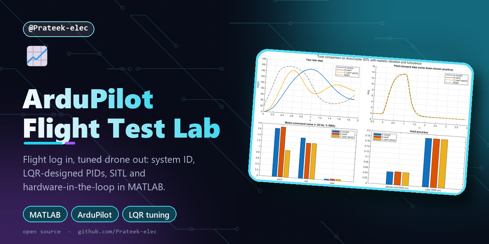
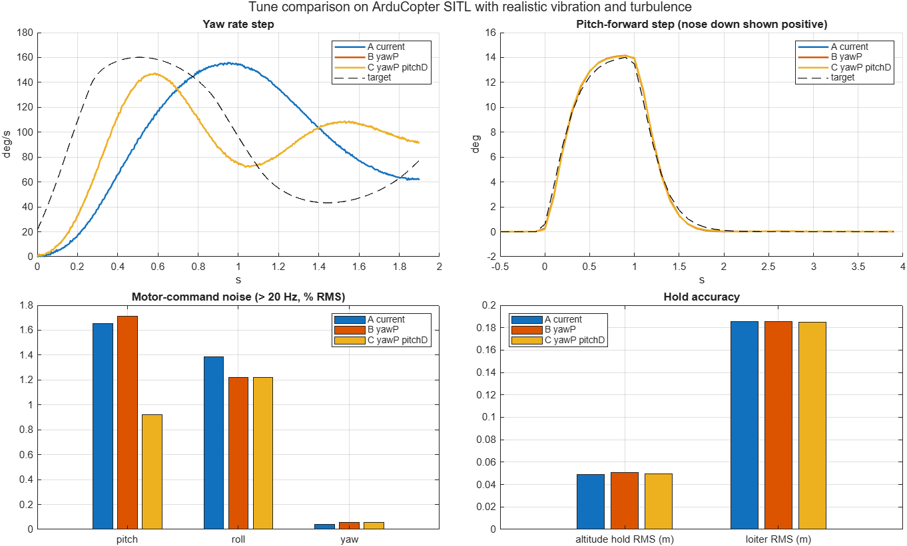
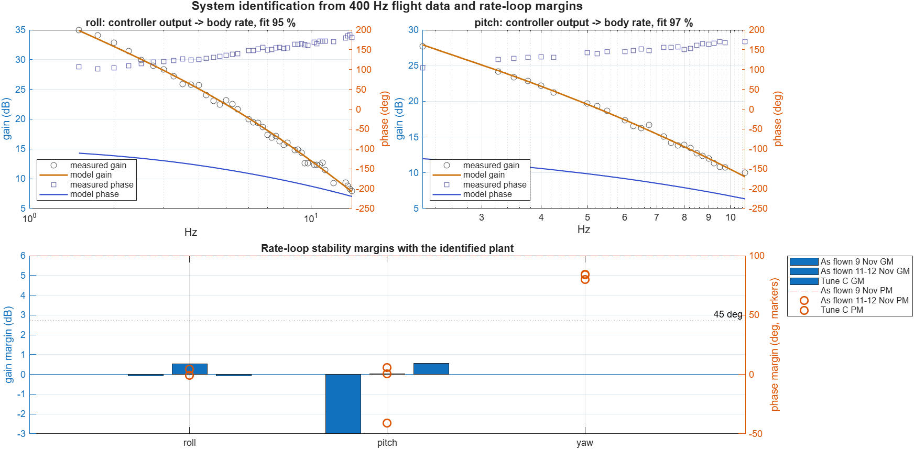
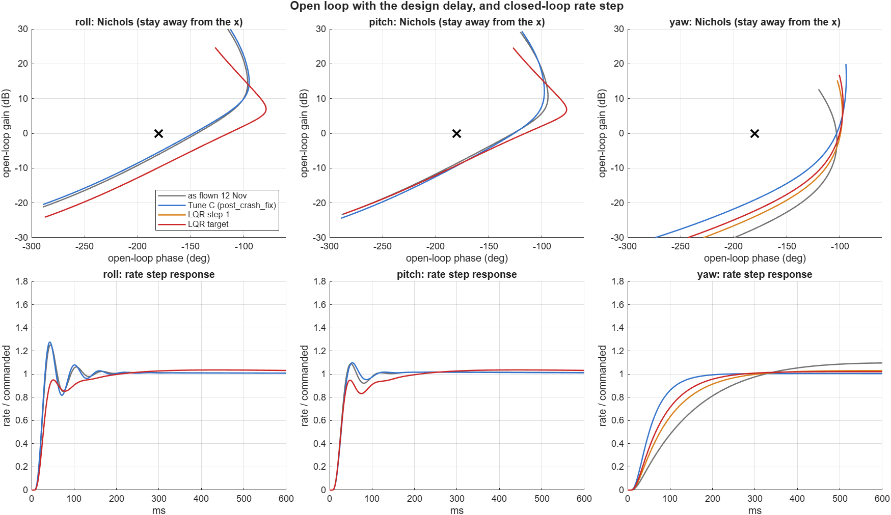
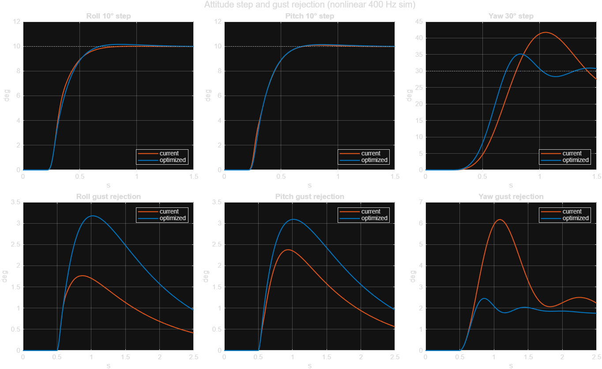

<div align="center">



**My drone crashed. The flight log knew why before I did.**

So I built a MATLAB lab that reads ArduPilot flight logs, finds the problem, identifies the airframe, designs better PID gains with LQR, proves them on real ArduCopter firmware (SITL) and on the real board (HIL), then writes the `.param` file to load.


</div>

---

## Highlights

- 📜 **Flight log in, tuned drone out:** pick a DataFlash `.BIN`, press Tune, load the `.param` it writes.
- 🧪 **Real firmware, simulated physics:** ArduCopter SITL flies a validated MATLAB 6-DOF quad model.
- 🎯 **Control theory, not guesswork:** the rate loop is identified from 400 Hz flight data, then LQR (LQI) designs the PID gains with phase- and gain-margin checks.
- 🔌 **Tested on the real board:** two-level hardware-in-the-loop, from I/O checks to full simulation-on-hardware missions.
- 📊 **Benchmark your board:** compare noise and tracking against 11 commercial flight controllers using public flight logs.

## The story

1. 💥 **The crash:** a 2S quad went down mid-flight.
2. 🔍 **The log review** (`fc_log_analysis`, `logs_review`) showed vibration jumping **~500×** (0.04 → 19 m/s²) right before it. The cause was mechanical: motor screws. That became the [post-crash checklist](post_crash_checklist.md).
3. 🧠 **Same logs, new tune:** the rate loop was identified from 400 Hz flight data and LQR designed new PID gains with proper margins.
4. 🧪 **Proved before flying:** the new tune was flown on ArduCopter SITL with turbulence and vibration, then on the real board in HIL.
5. 📜 **One command for next time:** all of it is packaged so any ArduPilot log goes in and a tuned `.param` comes out.

## The pipeline

```text
 ArduPilot .BIN log
        │
        ▼
 fc_log_analysis ──────────── health report (pass / fail)
        │
        ▼
 fc_identify_rate / fc_simulation ── grey-box airframe model per axis (K, τ, trim)
        │
        ▼
 lqr_pid_tuner / fc_tune_from_log ── LQR-designed rate + angle gains, margin-checked
        │
        ├──► run_sitl_bench ───── real ArduCopter (SITL) flying the MATLAB 6-DOF model
        ├──► hil_l1 / hil_l2 ──── the same tests on your physical flight controller
        ▼
 .param file + PDF tuning report (fc_tune_report)
```

## Results from a real tuning campaign

<table>
<tr>
<td width="50%"><br/><sub><b>Three tunes on SITL</b> with vibration and turbulence: step response, motor noise, hold accuracy</sub></td>
<td width="50%"><br/><sub><b>System identification</b> from 400 Hz flight data, with rate-loop margins</sub></td>
</tr>
<tr>
<td width="50%"><br/><sub><b>LQR-designed loops:</b> open-loop Nichols plots and closed-loop rate steps</sub></td>
<td width="50%"><br/><sub><b>Current vs optimised tune:</b> attitude step and gust rejection</sub></td>
</tr>
</table>

## Quick start

1. MATLAB **R2026a** with Control System Toolbox (LQR, margins). MATLAB Report Generator is optional, for PDF reports.
2. Put your ArduPilot DataFlash logs in a `logs/` folder next to this README.
3. Open the tuner:
   ```matlab
   addpath(genpath(pwd))
   fc_tuner_app
   ```
   Or run the full calibrated simulation on one log:
   ```matlab
   S = fc_simulation("logs/my_flight.BIN");
   ```
4. **Windows launcher (optional):** `launcher/build_launcher.bat` builds a small `FC Tuner.exe` that opens the tuner without the MATLAB desktop. `Open_FC_Tuner.bat` does the same without building anything.

## What's inside

| Path | What it does |
|---|---|
| `fc_simulation.m` | Flight-log-calibrated ArduCopter simulation: rebuilds the 400 Hz attitude and rate controllers, identifies the airframe, runs linear analysis and time-domain tests, and searches for a better tune |
| `fc_log_analysis.m` | Pass / fail health report from a DataFlash log |
| `fc_tuner_app.m` | **FC PID Tuner** app: pick logs, press Tune, get a `.param` |
| `fc_live_test.m`, `fc_fake_drone.m`, `fc_bridge.py` | Live MAVLink bench test, a fake-drone MAVLink source, and a serial-to-UDP bridge |
| `bench/` | 6-DOF physics (`quad_physics`, validated against analytic cases), SITL bridge, LQR tuner, PID design space, fleet analysis, board benchmark |
| `hil/` | Hardware-in-the-loop: setup check, Level 1 (board I/O, props off) and Level 2 (simulation on hardware). Start with `hil/HIL_RUNBOOK.md` |
| `fleet_results/`, `logs_review/`, `sim_results/`, `bench/results/` | Example outputs from a real tuning campaign: figures, CSV tables and the generated `.param` |
| `post_crash_checklist.md`, `*.param` | A post-crash checklist and example parameter changes |

## Bring your own

These aren't in the repo. Add them locally if you need those features:

| What | Needed for | Where to get it |
|---|---|---|
| Your flight logs (`logs/*.BIN`) | Everything | Your flight controller's SD card or Mission Planner |
| ArduCopter SITL build (`sitl/bin/`) | SITL runs | Build from the [ArduPilot](https://github.com/ArduPilot/ardupilot) repo |
| ArduPilot's MATLAB SITL reference files (`sitl/ardupilot_ref/`) | `validate_physics` V8 check | ArduPilot repo, MATLAB SITL examples |
| Public PX4 logs (`bench/px4_logs/`) | Board benchmark | [PX4 Flight Review](https://review.px4.io) |

## Safety

Bench-test with **props off**, check the generated parameters before flying, and fly the first test somewhere open, with a failsafe configured.

## License

[MIT](LICENSE) © Prateek Sarkar

---

<div align="center">

### Found this useful?

**Drop a ⭐ so more drone builders find it, and share it with someone fighting their PID tune.**

[](https://twitter.com/intent/tweet?text=Flight%20log%20in%2C%20tuned%20drone%20out%3A%20an%20open%20MATLAB%20toolkit%20for%20ArduPilot%20tuning%20%F0%9F%93%88&url=https%3A%2F%2Fgithub.com%2FPrateek-elec%2Fardupilot-flight-test-lab)
[](https://www.linkedin.com/sharing/share-offsite/?url=https%3A%2F%2Fgithub.com%2FPrateek-elec%2Fardupilot-flight-test-lab)
[](https://github.com/Prateek-elec)

</div>
